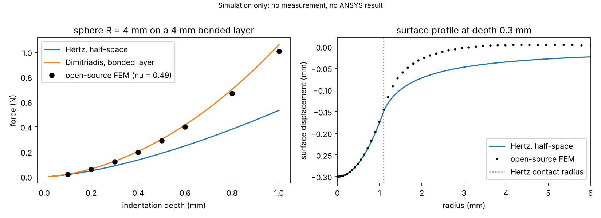

# Verification of the open-source FEM solver

`fea/axisym_fem.py` is an independent check on the ANSYS model and lets anyone
rebuild the dataset without an ANSYS licence. This page records how it was
checked. Everything here is simulation against formulas: there is no measurement
and no ANSYS result yet.

Reproduce with `cd fea && python verify_fem.py` (about two minutes).

## Results (20 November 2026)

Sphere radius 4 mm, shear modulus 0.05 MPa.

```
1. Half-space limit vs Hertz (layer 40 mm thick, 40 mm radius, nu = 0.49)
   depth_mm  fem_N      hertz_N    diff_%
   0.05      0.00590    0.00585    +0.98
   0.1       0.01664    0.01653    +0.61
   0.2       0.04688    0.04677    +0.24

2. Bonded 4 mm layer vs Dimitriadis (which assumes nu = 0.5, small strain)
   depth_mm  chi    nu      fem_N      dimitriadis_N  diff_%   hertz_only_diff_%
   0.1       0.158  0.49    0.01984    0.02048         -3.11   +17.6
   0.1       0.158  0.495   0.02008    0.02048         -1.97   +19.0
   0.3       0.274  0.49    0.12046    0.12469         -3.39   +37.5
   0.3       0.274  0.495   0.12190    0.12469         -2.24   +39.1
   0.5       0.354  0.49    0.28997    0.30103         -3.68   +53.8
   0.5       0.354  0.495   0.29345    0.30103         -2.52   +55.6

3. Mesh convergence (depth 0.3 mm, 4 mm layer, nu = 0.49)
   nr x nz   dof     force_N    change_%   seconds
   18x10     1460    0.121260              2.9
   24x14     2716    0.120557   -0.579     3.3
   36x20     5800    0.120463   -0.078     4.4
   54x30     13020   0.120324   -0.116     18.4

4. Contact penalty (depth 0.3 mm, default mesh)
   penalty_MPa_per_mm  force_N    max_penetration_mm
   50                  0.120249   7.93e-04
   200                 0.120463   2.00e-04
   800                 0.120515   5.07e-05
```

## Reading the results

1. **Half-space limit.** On a layer ten times thicker than the default, the force
   is within 1% of Hertz. The basic contact and material implementation is sound.
2. **Thin bonded layer.** On the default 4 mm layer the force is 18% to 56% above
   Hertz, and within 2% to 4% of the Dimitriadis correction. The remaining gap
   shrinks as Poisson's ratio moves from 0.49 to 0.495, which is the expected
   direction: the formula assumes exactly 0.5. The gap grows with depth, where
   the formula's small-strain assumption weakens.
3. **Mesh.** From the default mesh (36 x 20) to one with more than twice the
   unknowns the force changes by 0.12%.
4. **Penalty.** A sixteen-fold change in the contact penalty moves the force by
   0.2%. Penetration at the default is 0.0002 mm, under 0.1% of the depth.



The right-hand panel shows something Hertz cannot: outside the contact, the
surface of a bonded, nearly incompressible layer rises slightly instead of
sinking, because the displaced material has nowhere else to go. A tactile sensor
camera would see that ring.

## What this does not show

- Agreement with a real sensor. No experiment has been done.
- Agreement with ANSYS. That comparison is a week 3-8 task.
- Anything about friction, shear, or indenters that are not spheres on the axis.
  The solver is frictionless and axisymmetric.
- That the material model is right for the actual silicone. The shear modulus
  here is a placeholder until the compression tests are done.

## Dataset

`data/fem_open_v0.npz`: 160 cases, sphere radius 2 to 6 mm, depth 0.05 to 1.0 mm,
Latin hypercube sampling, seed 0, nu = 0.49, all 160 converged. Each case stores
the force and the surface deflection on a fixed 128-point radial grid. Rebuild:

```
cd fea && python run_batch.py --backend fem --workers 2 --n 160 --out ../data/fem_open_v0.npz
```

Baselines trained on it (`surrogate/`), split with the deepest 15% of cases held
out as out-of-range:

| Model | In-range error | Out-of-range error |
| --- | --- | --- |
| Force, small MLP | mean 0.8%, max 2.7% | mean 4.4%, max 11.4% |
| Surface profile, PCA (8 modes) + MLP | mean 0.4%, max 2.0% relative L2 | mean 0.7%, max 1.8% |

These are baselines on simulated data for the simplest case. The v1 model has to
beat them on the ANSYS dataset, and the out-of-range force error shows where a
surrogate should not be trusted.
